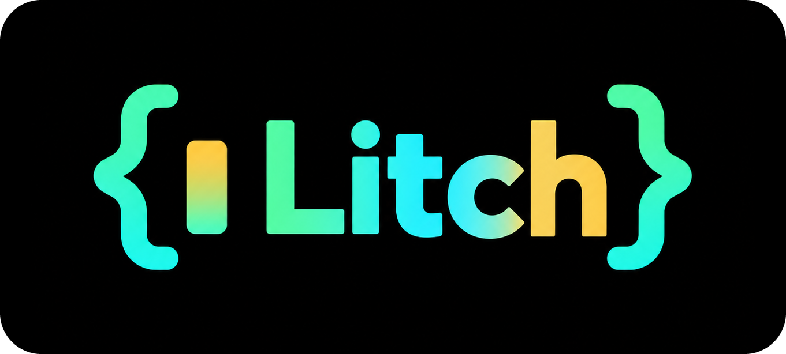
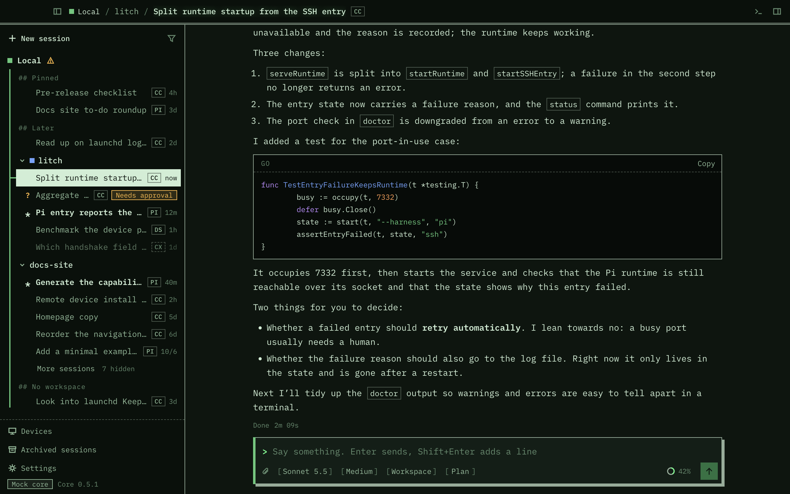
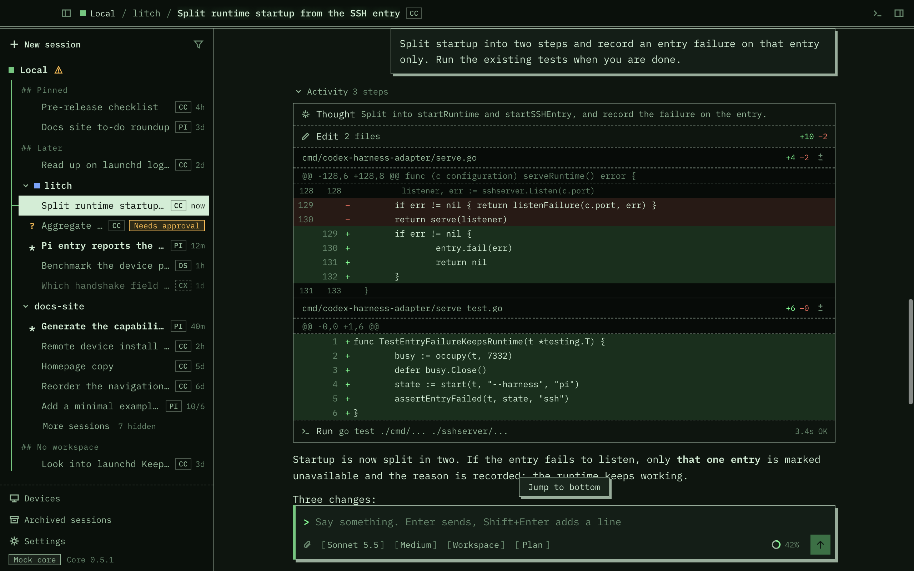
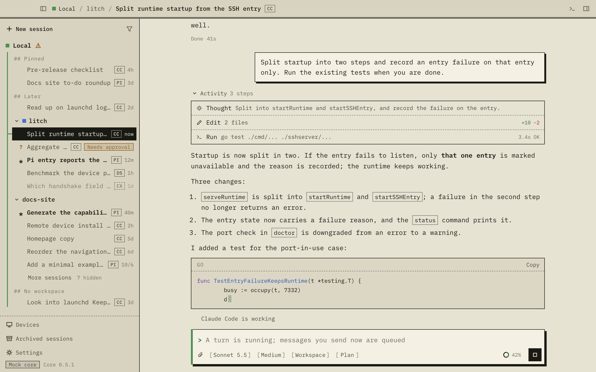
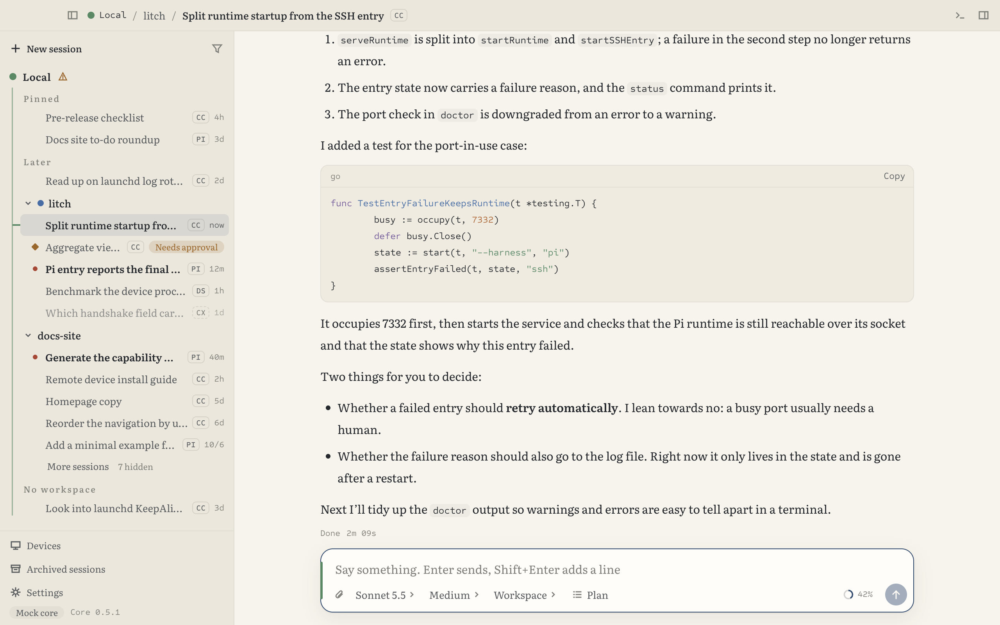
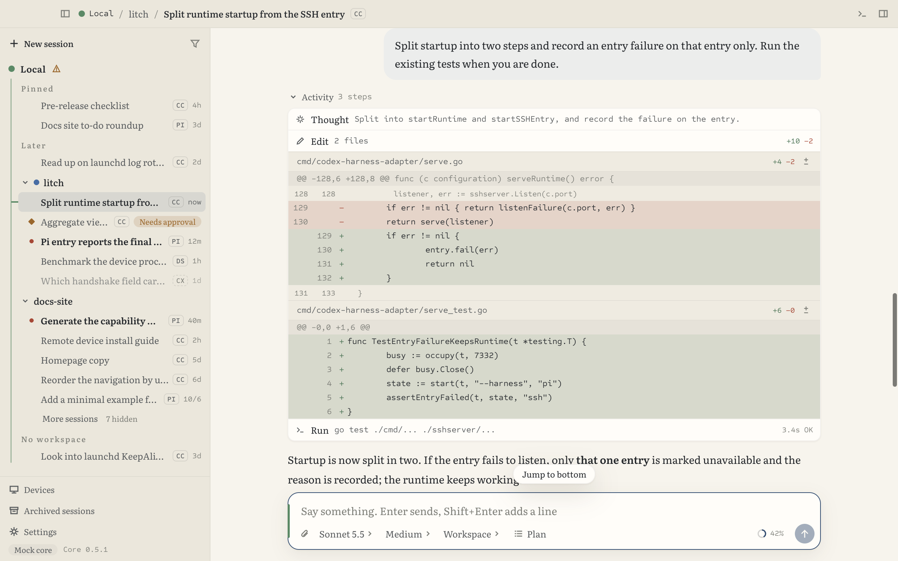
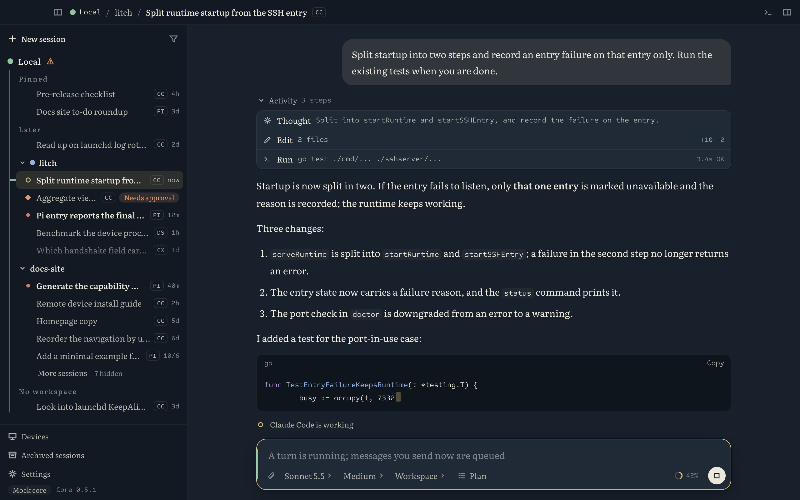

<p align="center">
  
</p>

# Litch

[简体中文](README.md) | **English**

Litch aims to be a comfortable desktop client with a great remote-connection experience.

- Direct SSH connections
- Mobile (Android and iOS) connects straight to remote devices over SSH, no desktop needed
- Built-in browser + Computer Use (macOS and Windows)
- While the desktop is connected, remote devices can use its browser and Computer Use, and, once you approve, run commands and read and write files on it
- Session trees (spawn sub-sessions across harnesses, report back and wake the parent) and scheduled tasks (run on the device on schedule, even with the desktop closed)
- Scan a QR code to add a device the desktop already connects to onto your phone, with no SSH key setup on the phone

<p></p>

## Screenshots

### Retro (default)

<p></p>
<p></p>

### Literary

<details>
<summary>Show the Literary skin</summary>

<p></p>
<p></p>
<p></p>

</details>

The screenshots show demo data. Skin, light or dark, and language (中文 / English) can be switched at any time.

## Features

- **Remote connections.** Use your own SSH config and keys. The device's SSH server must be reachable; no additional Litch port needs to be exposed. Dropped connections reconnect automatically.
- **Multiple harnesses.** Claude Code, Pi, Codex, plus experimental DeepSeek Harness (DSH), OpenCode and ACP agents (Gemini CLI, Qwen Code and more), all in one window.
- **Browsers.** Share the built-in browser with your agent, with remote localhost forwarded over SSH. The Chrome extension also lets agents use tabs and sites you approve.
- **Computer Use (macOS and Windows).** Once enabled, agents can operate ordinary apps; access to the released Litch app itself requires separate approval. An on-screen notice shows activity, and Esc stops it.
- **Operate this computer.** Once you approve, agents on remote devices can run commands, read and write files, and copy files between the two machines on the desktop computer. Off by default, turned on per device.
- **Session trees.** A session can spawn sub-sessions across harnesses (a Claude Code session can spawn Codex or Pi sub-sessions, and the other way round), shown nested under it; when a sub-session finishes it reports back, and the parent is woken to carry on when needed.
- **Scheduled tasks.** Tasks live on the device and the device runs them on schedule, even while the desktop is closed or disconnected; each run starts a new session or continues an existing one.
- **Pair a phone by QR code.** The desktop (or `litch pair` on that machine) shows a QR code; the phone scans it, creates its own key and enrolls it on that machine, and you confirm a matching code on the computer. The computer's keys never leave it, and each phone can be revoked on its own.
- **Panels for coding.** A terminal that survives a dropped connection, a file tree, and diff review.
- **Mobile (Android and iOS).** Connect directly over SSH to browse sessions, send messages, answer approvals, open terminals and manage scheduled tasks. QR pairing and tablet split views are supported.

Android and iOS include Tailscale without occupying the system VPN, so it can coexist with your own VPN. Choose Auto, Always or Never; once the built-in node is signed in, Auto recognizes tailnet addresses without manual switching. See the [phone connection guide](skills/litch-manual/references/phones.md#内嵌-tailscale-网络).

## Status

| Part | Status |
|---|---|
| Adapter `codex-harness-adapter` | Connects multiple harnesses on one device. See [install and usage](ADAPTER.en.md) |
| Desktop client | Installers for macOS (Apple Silicon) and Windows, with the adapter included. Supports local and remote sessions, browsers, Computer Use, and approved command and file operations on the desktop computer |
| Android client | Available as an APK, with sessions, approvals, terminals, files, managers and scheduled tasks |
| iOS client | Available on the App Store, with remote sessions, approvals, terminals, files, managers and scheduled tasks. iOS releases separately from the desktop and Android apps |

See the [product manual](skills/litch-manual/SKILL.md) for features and platform limitations.

## Shared modules

Computer Use, the built-in browser and Chrome control are split into standalone packages that other desktop apps can embed. All three share the tool definitions and host interfaces (invocation and cancellation, approvals, state storage and more) in [`third_party/litch-automation/packages/automation-contracts`](third_party/litch-automation/packages/automation-contracts). Paths, identities and approval UI are passed in by the host; importing a package does not read your home directory or register anything.

- **[Computer Use](third_party/litch-automation/packages/computer-use).** An executor for operating ordinary macOS and Windows apps, which launches, supervises and talks to a native helper. It needs only Node 24, not Electron; the host builds and signs the native helper itself and ships it with its own app.
- **[Built-in browser](third_party/litch-automation/packages/browser).** A CDP-based browser tool executor with site permissions, sign-in autofill, and cookie and password import. Electron hosts plug in through the `/electron` subpath; the default entry does not load Electron, so other hosts supply their own CDP page host or implement the semantic `BrowserDriver` interface directly.
- **Chrome control.** The [extension library](third_party/litch-automation/packages/chrome-extension) assembles the host's own MV3 extension (with its own extension ID and host name) and provides tab leases and a restricted CDP executor. The [native bridge](third_party/litch-automation/packages/chrome-bridge) registers Native Messaging from a Node process, talks to the extension and provides the AI tool executor, without Electron.

These modules are integrated as source under `third_party/litch-automation`, from the MIT-licensed [slovx2/litch-automation](https://github.com/slovx2/litch-automation) code library (npm packages have not been published yet), with `@litch/*` npm packages using independent semver starting at 0.x. The repository provides macOS Swift and Windows Rust helper sources and build scripts, without signing, notarization, application packaging or precompiled helper releases. Consumers build and distribute helpers with their own applications. Each package README documents integration and limitations.

## Download

Desktop and Android installer filenames include a version number. The fixed links below open the latest release; choose the matching file under Assets.

| System | Download or install | Notes |
|---|---|---|
| macOS (Apple Silicon) | [Latest release](https://github.com/slovx2/litch/releases/latest): `Litch-<version>-macos-arm64.dmg` | Signed and notarized by Apple. Open it and drag Litch into Applications |
| Windows (x64) | [Latest release](https://github.com/slovx2/litch/releases/latest): `Litch-<version>-windows-x64-setup.exe` | Supports Windows 11 with Windows PowerShell terminals. Administrator accounts cannot yet pair phones by QR code. The installer is unsigned and installs for the current user without administrator rights |
| Android (arm64, Android 7.0 or later) | [Latest release](https://github.com/slovx2/litch/releases/latest): `Litch-<version>-android-arm64.apk` | Install it directly; the first time, Android asks you to allow installing unknown apps. The app generates its own SSH key; add its public key to the remote machine's `authorized_keys` to connect |
| iOS | [App Store](https://apps.apple.com/app/id6831062826) | iPhone and iPad; released separately |
| Device adapter | [Install and usage](ADAPTER.en.md#install-and-run) | Install script, source setup and remote device configuration for Linux and macOS |
| Homebrew (macOS) | `brew install slovx2/tap/codex-harness-adapter` · [Usage](ADAPTER.en.md#macos-homebrew-background-service) | Installs the device adapter; supports Apple Silicon |

The app ships with its own copy of the adapter and, when opened, gathers the Claude Code, Pi, DSH, OpenCode and codex installed on this machine under the device named Local; install and sign in to those harnesses separately. There is no installer for Intel Macs yet; run it from source there.

It also installs a skill, the Litch manual (`litch-manual`, source in [`skills/litch-manual`](skills/litch-manual)), into the harnesses on this machine (`~/.agents/skills`, linked into `~/.claude/skills` and others), so an agent can explain Litch and change its settings through the `litch config` command; turn this off in Settings.

## Run from source

Requires Node.js 24.

```sh
git clone https://github.com/slovx2/litch.git
cd litch
npm ci
npm run client:setup
npm run client:start:mock
```

That shows demo data. To see real sessions, start the adapter as described in the [adapter guide](ADAPTER.en.md), then hand its socket to the client:

```sh
LITCH_ENTRY=~/.codex-harness-adapter/pi/runtime.sock npm run client:start
```

Replace `pi` with `claude-code`; use `~/.codex-harness-adapter/device/device.sock` to get every harness over one connection; or point it at the socket of a native codex started with `codex app-server --listen unix://<path>`.

On macOS you can package it into an app you can open directly. It lands under `apps/desktop/out`. Run `npm run client:setup` from above first; the app ships with its own copy of the adapter, so the adapter has to be built too (this needs Go):

```sh
npm run setup
npm run client:pack
open apps/desktop/out/Litch-darwin-arm64/Litch.app
```

When it opens, it starts that adapter by itself, and the Claude Code, Pi, DSH, OpenCode and codex installed on this machine show up under the device named Local (codex uses your own data, in `~/.codex` by default; disable it on the Devices page if you do not want it). A harness that is not installed says why; on the Devices page you can give the path to its command or disable it. The adapter keeps its state in `~/.codex-harness-adapter`, shared with a standalone install of the adapter. The service keeps running after you quit the app, so sessions are not interrupted.

An app you package yourself is only ad-hoc signed for this machine, so another Mac will refuse to open it. Computer Use permissions are tied to the signature too, so every repackage needs them granted again. To give it to someone else, or to use Computer Use for long, use the installer from the releases page.

## Docs

[Adapter install and usage](ADAPTER.en.md) · [Development conventions](AGENTS.md) (Chinese) · [Contributing](CONTRIBUTING.md)

---

The adapter is based on [fuergaosi233/claude-codex](https://github.com/fuergaosi233/claude-codex). [MIT](LICENSE) · [Third-party notices](THIRD_PARTY_NOTICES.md)
