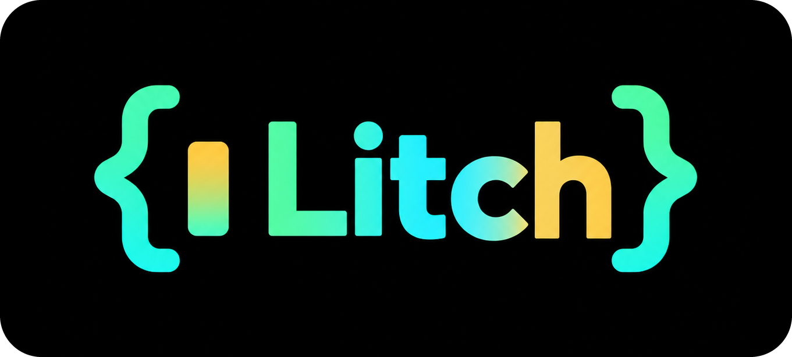
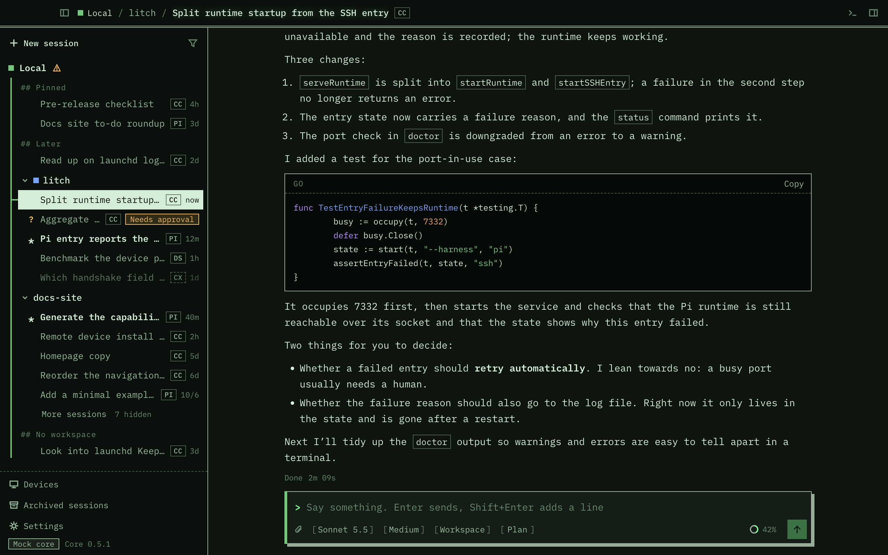
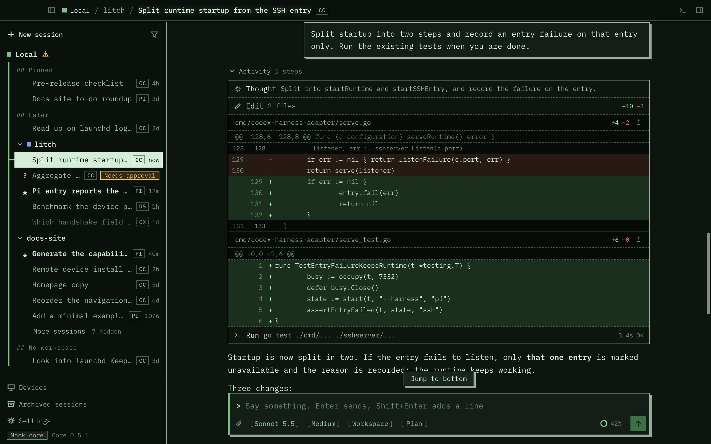
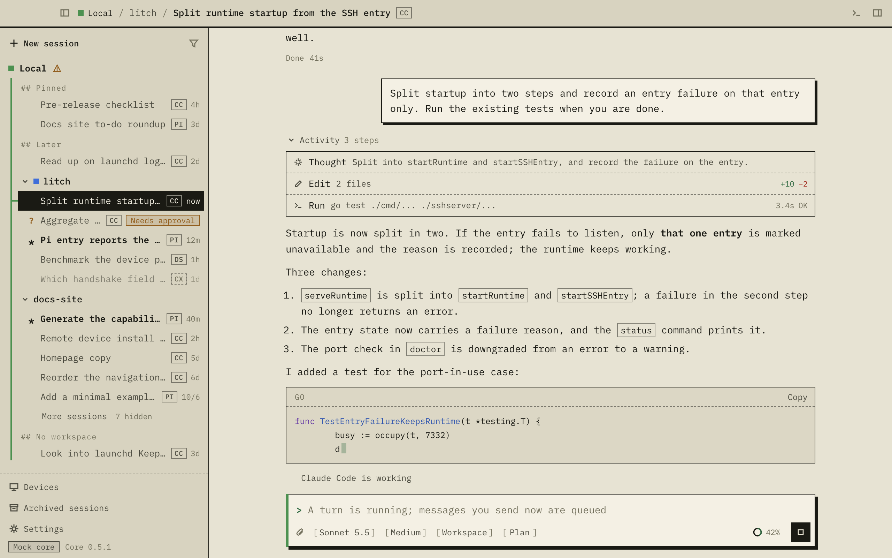
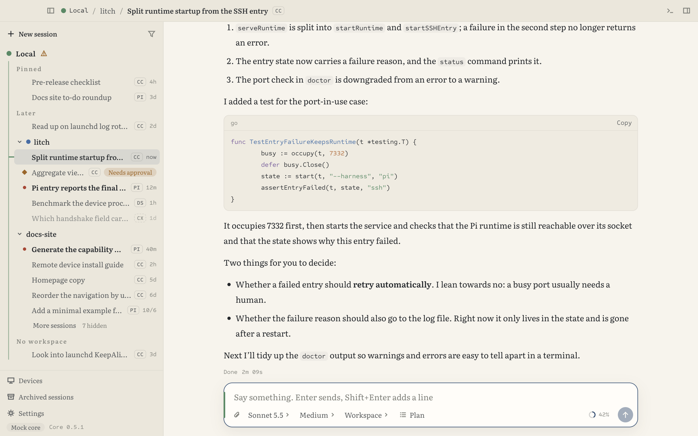
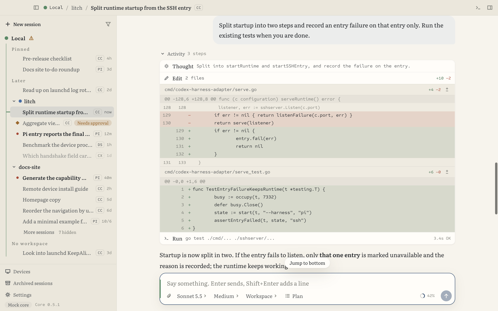
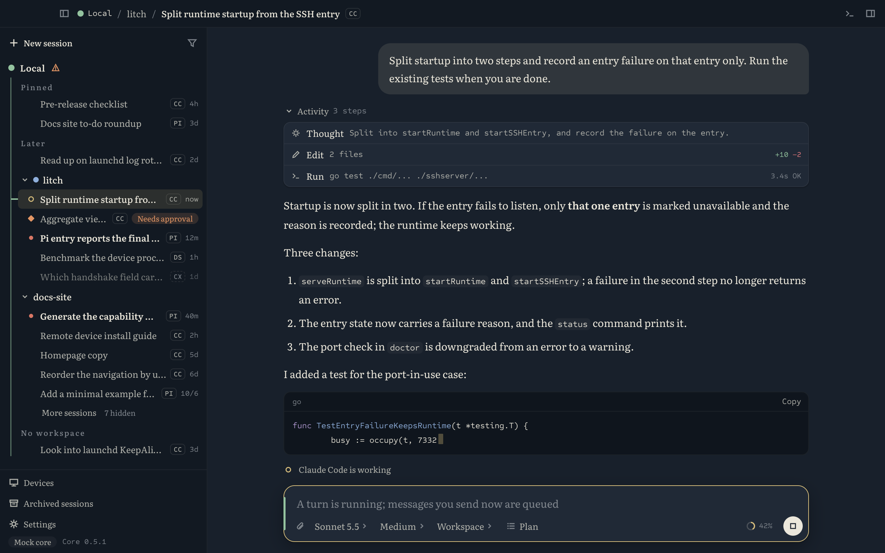

<p align="center">
  
</p>

# Litch

[简体中文](README.md) | **English**

Litch aims to be a comfortable desktop client with a great remote-connection experience.

- Direct SSH connections
- Built-in browser + Computer Use (macOS and Windows)
- While the desktop is connected, remote devices can use its browser and Computer Use, and, once you approve, run commands and read and write files on it
- Session trees (spawn sub-sessions, report back and wake the parent) and scheduled tasks (run on the device on schedule, even with the desktop closed)
- Scan a QR code to add a device the desktop already connects to onto your phone, with no SSH key setup on the phone

## Screenshots

### Retro (default)

<p>
  
  
  
</p>

### Literary

<p>
  
  
  
</p>

The screenshots show demo data. Skin, light or dark, and language (中文 / English) can be switched at any time.

## Features

- **Remote connections.** Connect through your own ssh config and keys, with no port opened on either side; dropped connections reconnect by themselves and running turns are not lost.
- **Multiple harnesses.** Claude Code, Pi, Codex, plus experimental DeepSeek Harness (DSH), OpenCode and ACP agents (Gemini CLI, Qwen Code and more), all in one window.
- **Built-in browser.** Shared by you and the agent; the remote machine's localhost is forwarded over ssh.
- **Computer Use (macOS and Windows).** The agent operates apps on this computer, and each app needs your approval before the first action; a notice shows on screen while it works, and Esc stops it.
- **Operate this computer.** Once you approve, agents on remote devices can run commands, read and write files, and copy files between the two machines on the desktop computer. Off by default, turned on per device.
- **Session trees.** A session can spawn sub-sessions on any harness, shown nested under it; when a sub-session finishes it reports back, and the parent is woken to carry on when needed.
- **Scheduled tasks.** Tasks live on the device and the device runs them on schedule, even while the desktop is closed or disconnected; each run starts a new session or continues an existing one.
- **Pair a phone by QR code.** The desktop (or `litch pair` on that machine) shows a QR code; the phone scans it, creates its own key and enrolls it on that machine, and you confirm a matching code on the computer. The computer's keys never leave it, and each phone can be revoked on its own.
- **Panels for coding.** A terminal that survives a dropped connection, a file tree, and diff review.
- **Android client.** Browse sessions, send messages, answer approvals and open terminals from your phone.

## Status

| Part | Status |
|---|---|
| Adapter `codex-harness-adapter` | Usable. Lets the Codex desktop app drive Claude Code, Pi and the experimental DSH, OpenCode and ACP agents directly; Litch also reaches all the harnesses on a machine through it. See [install and usage](ADAPTER.en.md) |
| Desktop client Litch | Early development. Installers are available for macOS (Apple Silicon) and Windows (see Download below; a few features don't work on Windows yet), or run it from source. The app ships with its own copy of the adapter and gathers the harnesses installed on this machine under one device, Local. You can browse sessions, send messages (with images and attachments), queue, interrupt and steer, answer approvals and questions, and use plan mode, `/` commands and `@` to find files. When starting a session you pick the device, project and harness, and sessions from different harnesses in the same folder share one workspace. The side panel has a terminal, files and diff review. The Devices page can enable or disable a harness, change its settings, and show diagnostics and logs. It can also connect over SSH to the device service or native codex on a remote machine |
| Built-in browser, Computer Use | Available since 0.8.0; Computer Use on macOS since 0.8.0 and on Windows since 0.10.0. Agents on remote devices can use both capabilities of the desktop (the adapter there needs 0.8.0 or later) |
| Operate this computer | Available since 0.10.0; the desktop side is macOS only for now. Sessions on remote devices operate the desktop computer's commands and files once you approve; Codex, Claude Code and Pi sessions use the tools directly, other harnesses use the `litch-machine` command on that machine (the adapter there needs 0.10.0 or later) |
| Android client | Available since 0.9.0, early version. Connects over SSH to remote machines with the adapter installed: browse sessions, send messages, answer approvals, open terminals; manages scheduled tasks since 0.11.0 |
| Session trees | Available since 0.11.0. The model spawns sub-sessions and reads and writes its own sub-sessions through `litch_sessions`, and you can spawn them by hand in the UI. Available in Codex, Claude Code, Pi, dsh and OpenCode sessions; ACP agent sessions cannot spawn but can be sub-sessions (the adapter on that machine needs 0.11.0 or later) |
| Scheduled tasks | Available since 0.11.0. Schedules follow the device's time zone, and the model can create tasks through `litch_tasks`; manage them from the desktop or the Android client (the adapter on that machine needs 0.11.0 or later) |
| Pair a phone by QR code | Available since 0.12.0. Add the device in the Android client by scanning; you can change the address the phone uses before showing the code (the phone must reach it directly; jump hosts are not supported). For this computer itself, turn on the system SSH server first (Remote Login on macOS). The adapter on that machine needs 0.12.0 or later; Windows devices are not fully tested |

## Download

Get it from the [releases page](https://github.com/slovx2/litch/releases/latest):

| System | File | Notes |
|---|---|---|
| macOS (Apple Silicon) | `Litch-<version>-macos-arm64.dmg` | Signed and notarized by Apple. Open it and drag Litch into Applications |
| Windows (x64) | `Litch-<version>-windows-x64-setup.exe` | The main features have been checked on Windows 11 (the terminal runs Windows PowerShell). **Operate this computer and native Codex don't work on Windows yet**, and an administrator account on Windows can't pair a phone by QR code yet. The installer is not signed, so Windows warns that the publisher is unknown: click "More info", then "Run anyway". It installs for the current user only and does not need administrator rights |
| Android (arm64, Android 7.0 or later) | `Litch-<version>-android-arm64.apk` | Install it directly; the first time, Android asks you to allow installing unknown apps. The app generates its own SSH key; add its public key to the remote machine's `authorized_keys` to connect |

The app ships with its own copy of the adapter and, when opened, gathers the Claude Code, Pi, DSH, OpenCode and codex installed on this machine under the device named Local; install and sign in to those harnesses separately. There is no installer for Intel Macs yet; run it from source there.

It also installs a skill, the Litch manual (`litch-manual`, source in [`skills/litch-manual`](skills/litch-manual)), into the harnesses on this machine (`~/.agents/skills`, linked into `~/.claude/skills` and others), so an agent can explain Litch and change its settings through the `litch config` command; turn this off in Settings.

## Run from source

Requires Node.js 24.

```sh
git clone https://github.com/slovx2/litch.git
cd litch
npm run client:setup
npm run client:start:mock
```

That shows demo data. To see real sessions, start the adapter as described in the [adapter guide](ADAPTER.en.md), then hand its socket to the client:

```sh
LITCH_ENTRY=~/.codex-harness-adapter/pi/runtime.sock npm run client:start
```

Replace `pi` with `claude-code`; use `~/.codex-harness-adapter/device/device.sock` to get every harness over one connection; or point it at the socket of a native codex started with `codex app-server --listen unix://<path>`.

On macOS you can package it into an app you can open directly. It lands under `apps/desktop/out`. Run `npm run client:setup` from above first; the app ships with its own copy of the adapter, so the adapter has to be built too (this needs Go):

```sh
npm ci
npm ci --prefix packages/claude
npm ci --prefix packages/pi
npm ci --prefix packages/dsh
npm ci --prefix packages/opencode
npm ci --prefix packages/acp
npm run build
npm run client:pack
open apps/desktop/out/Litch-darwin-arm64/Litch.app
```

When it opens, it starts that adapter by itself, and the Claude Code, Pi, DSH, OpenCode and codex installed on this machine show up under the device named Local (codex uses your own data, in `~/.codex` by default; disable it on the Devices page if you do not want it). A harness that is not installed says why; on the Devices page you can give the path to its command or disable it. The adapter keeps its state in `~/.codex-harness-adapter`, shared with a standalone install of the adapter. The service keeps running after you quit the app, so sessions are not interrupted.

An app you package yourself is only ad-hoc signed for this machine, so another Mac will refuse to open it. Computer Use permissions are tied to the signature too, so every repackage needs them granted again. To give it to someone else, or to use Computer Use for long, use the installer from the releases page.

## Docs

[Adapter install and usage](ADAPTER.en.md) · [Development conventions](AGENTS.md) (Chinese) · [Contributing](CONTRIBUTING.md)

---

The adapter is based on [fuergaosi233/claude-codex](https://github.com/fuergaosi233/claude-codex). [MIT](LICENSE) · [Third-party notices](THIRD_PARTY_NOTICES.md)
