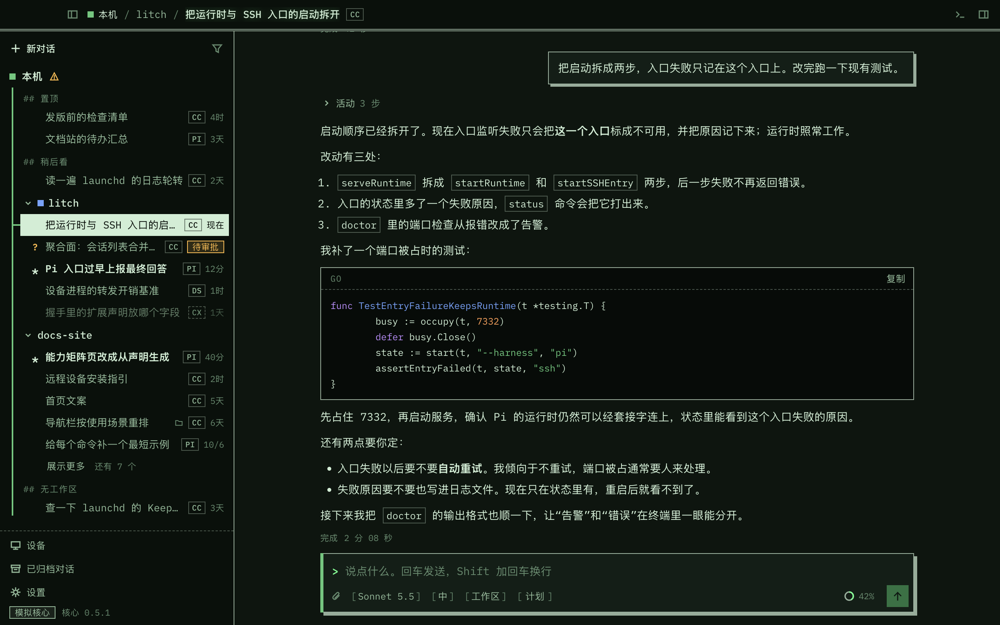
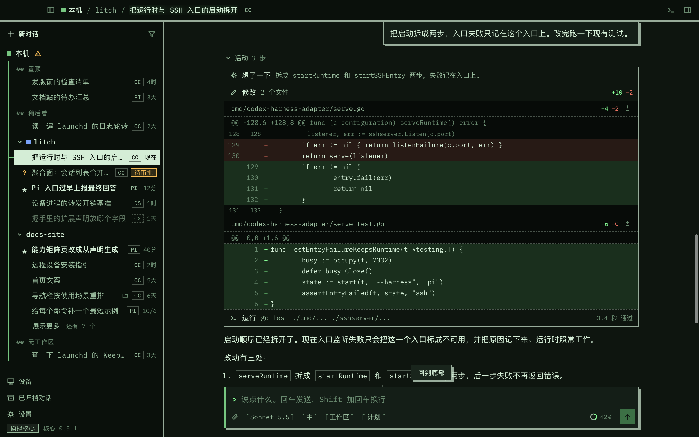
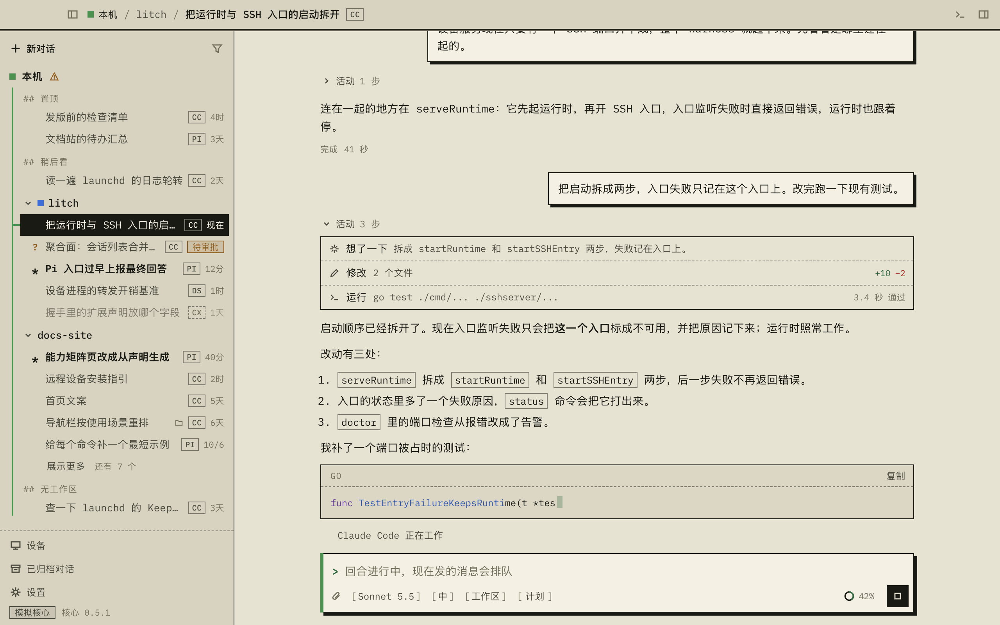
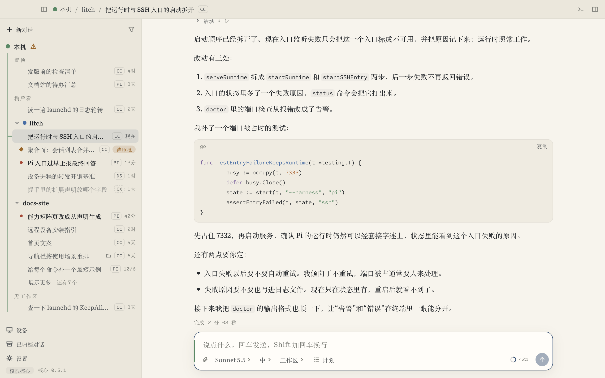
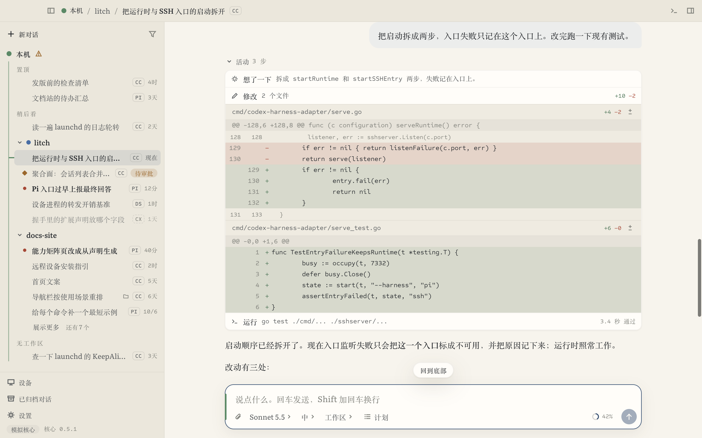
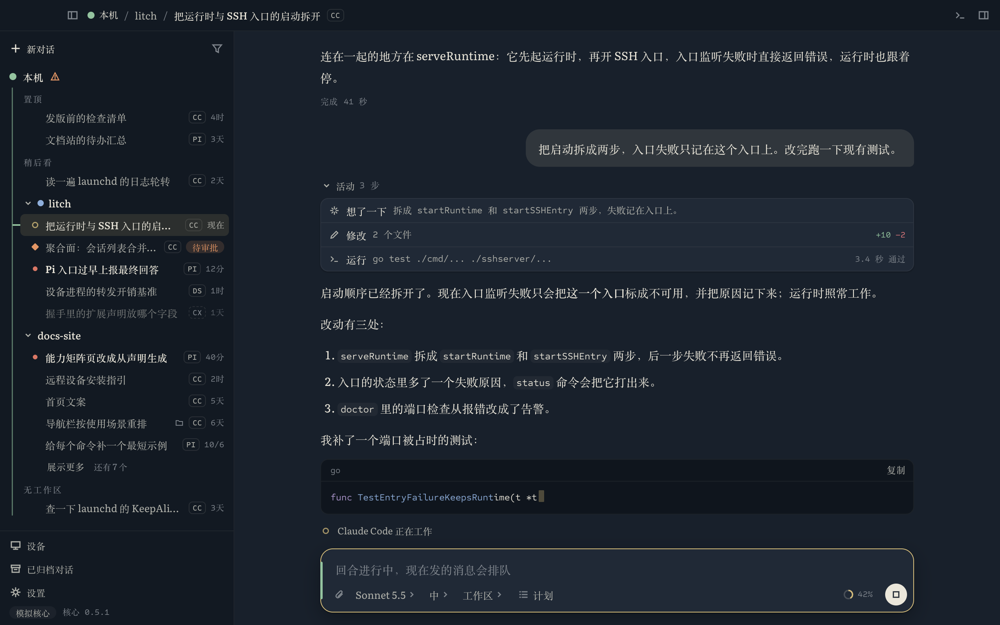

<p align="center">
  
</p>

# Litch

**简体中文** | [English](README.en.md)

Litch 致力于打造舒适的桌面客户端 + 远程连接体验。

- SSH 直连
- 内置浏览器 + Computer Use（macOS、Windows）
- 当桌面连接时，远程设备可使用桌面浏览器和 Computer Use 功能，经你点头后还能在这台电脑上跑命令、读写文件

## 界面

### 极客复古（默认）

<p>
  
  
  
</p>

### 文艺人文

<p>
  
  
  
</p>

截图里是演示数据。皮肤、明暗、语言（中文 / English）都可以随时切换。

## 特性

- **远程连接。** 经你自己的 ssh 配置和密钥连过去，两边都不开端口；断线自己重连，回合不丢。
- **多种 harness。** Claude Code、Pi、Codex，以及实验性的 DeepSeek Harness（DSH）、OpenCode 和 ACP agent（Gemini CLI、Qwen Code 等），收在同一个窗口里。
- **内置浏览器。** 你和代理共用；远端的 localhost 自动经 ssh 转发过来。
- **Computer Use（macOS、Windows）。** 代理操作这台电脑上的应用，每个应用第一次操作前要你批准；操作时屏幕上有提示，按 Esc 就停。
- **操作这台电脑。** 远程设备上的代理经你点头后在桌面这台电脑上跑命令、读写文件、在两台机器之间复制文件；默认关，按设备打开。
- **写代码的面板。** 终端（断线不丢）、文件树、差异审阅。
- **安卓客户端。** 在手机上看会话、发消息、审批、开终端。

## 当前状态

| 部分 | 状态 |
|---|---|
| 适配器 `codex-harness-adapter` | 可用。让 Codex 桌面端直接驱动 Claude Code、Pi 和实验性的 DSH、OpenCode、ACP agent；Litch 也经它连一台机器上的全部 harness。见[安装与使用](ADAPTER.md) |
| 桌面客户端 Litch | 早期开发。有 macOS（Apple Silicon）和 Windows 的安装包（见下面“下载”，Windows 版未经过完整测试），也可以从源码运行。应用自带一份适配器，打开就把本机上装了的 harness 收在“本机”这台设备下。能浏览会话，发消息（可带图片和附件），排队、打断与引导，回答审批和提问，用计划模式、`/` 命令和 `@` 找文件；新建会话时选设备、项目和 harness，同一个目录下各 harness 的会话归在同一个项目；侧面板里有终端、文件和差异审阅；设备页里可以启用、停用一个 harness，改它的设置，看诊断和日志。也能经 SSH 连远程机器上的设备服务或原生 codex |
| 内置浏览器、Computer Use | 0.8.0 起提供；Computer Use 0.8.0 起有 macOS 版，0.10.0 起有 Windows 版。远程设备上的代理也能用桌面这两项能力（那台机器上的适配器要 0.8.0 或更新） |
| 操作这台电脑 | 0.10.0 起提供，桌面端目前只支持 macOS。远程设备上的会话经你点头后操作桌面这台电脑的命令和文件；Codex、Claude Code、Pi 的会话直接用工具，其余 harness 用那台机器上的 `litch-machine` 命令（那台机器上的适配器要 0.10.0 或更新） |
| 安卓客户端 | 0.9.0 起提供，早期版本。经 SSH 连装了适配器的远程机器：看会话、发消息、审批、开终端 |

## 下载

从[发布页](https://github.com/slovx2/litch/releases/latest)下载：

| 系统 | 文件 | 说明 |
|---|---|---|
| macOS（Apple Silicon） | `Litch-<版本>-macos-arm64.dmg` | 签过名，经过苹果公证。打开后把 Litch 拖进“应用程序” |
| Windows（x64） | `Litch-<版本>-windows-x64-setup.exe` | **未经过完整测试**，可能有用不了的地方。安装程序没有签名，Windows 会提示来源不明，点“更多信息”再点“仍要运行”。只装给当前用户，不要管理员权限 |
| 安卓（arm64，Android 7.0 及以上） | `Litch-<版本>-android-arm64.apk` | 直接安装，第一次系统会让你允许“安装未知应用”。应用自己生成一把 SSH 钥匙，把它的公钥加到远程机器的 `authorized_keys` 里就能连 |

应用自带一份适配器，打开就把本机上装了的 Claude Code、Pi、DSH、OpenCode 和 codex 收在“本机”这台设备下；这些 harness 本身要另外装好并登录。Intel 芯片的 Mac 暂时没有安装包，可以从源码运行。

## 从源码运行

需要 Node.js 24。

```sh
git clone https://github.com/slovx2/litch.git
cd litch
npm run client:setup
npm run client:start:mock
```

这样看到的是演示数据。要看真实的会话，先按[适配器说明](ADAPTER.md)把适配器跑起来，再把它的套接字交给客户端：

```sh
LITCH_ENTRY=~/.codex-harness-adapter/pi/runtime.sock npm run client:start
```

`pi` 可以换成 `claude-code`；换成 `~/.codex-harness-adapter/device/device.sock` 就是一条连接里有全部 harness；也可以填原生 codex 用 `codex app-server --listen unix://<路径>` 监听的套接字。

在 macOS 上可以打成一个能直接打开的应用，放在 `apps/desktop/out` 下面。先跑过上面的 `npm run client:setup`；它自带一份适配器，所以还要把适配器构建出来（需要 Go）：

```sh
npm ci
npm ci --prefix packages/claude
npm ci --prefix packages/pi
npm ci --prefix packages/dsh
npm ci --prefix packages/opencode
npm ci --prefix packages/acp
npm run build
npm run client:pack
open apps/desktop/out/Litch-darwin-arm64/Litch.app
```

打开之后它会自己拉起那份适配器，本机上装了的 Claude Code、Pi、DSH、OpenCode 和 codex 出现在“本机”这台设备下（codex 用的是你自己的那份数据，默认在 `~/.codex`，不想要可以在设备页里停用）；没装的会写明原因，在设备页里可以填命令的路径或者停用。适配器的状态目录是 `~/.codex-harness-adapter`，和独立安装的适配器共用；退出应用后服务留着，会话不断。

自己打的这一份只做了本机的临时签名，换一台机器打开会被系统拦下；Computer Use 的系统权限也认签名，每重新打一次包就要重新授权。要给别人用、或者长期用 Computer Use，用发布页上的安装包。

## 文档

[适配器的安装与使用](ADAPTER.md) · [开发约定](AGENTS.md) · [参与开发](CONTRIBUTING.md)

---

适配器基于 [fuergaosi233/claude-codex](https://github.com/fuergaosi233/claude-codex)。[MIT](LICENSE) · [第三方许可](THIRD_PARTY_NOTICES.md)
