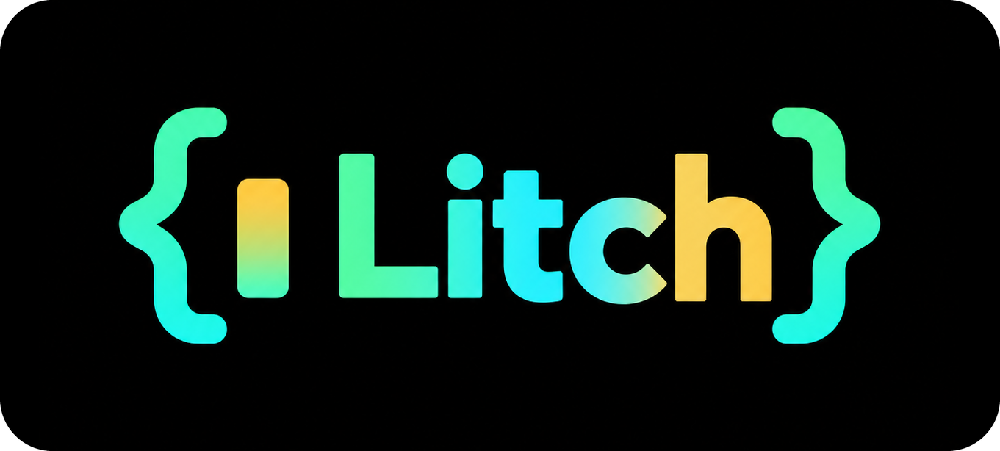
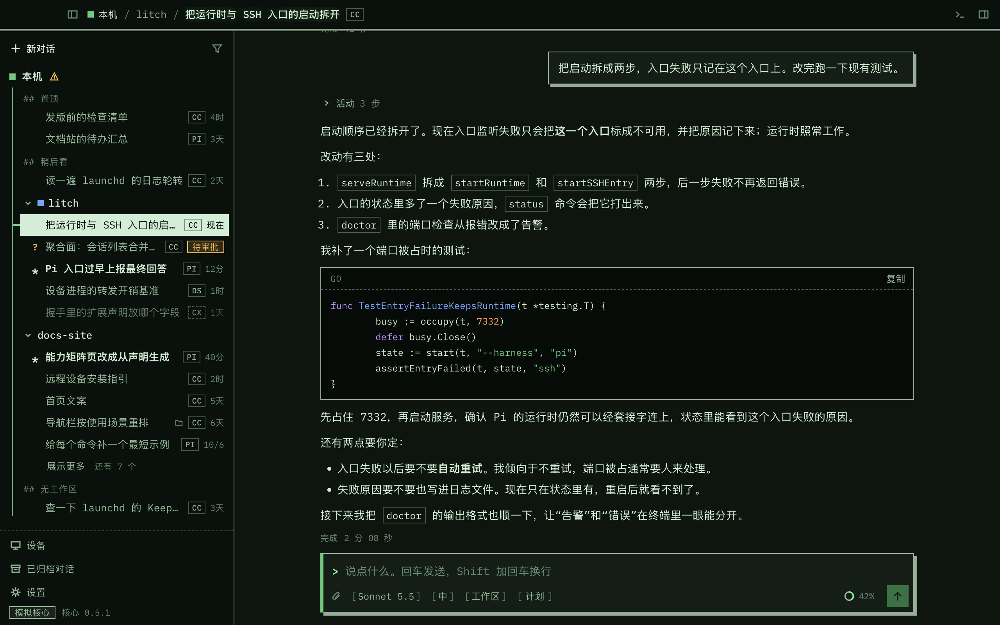
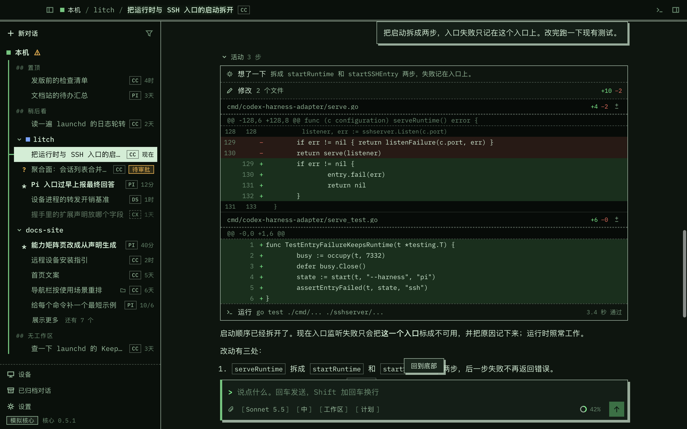
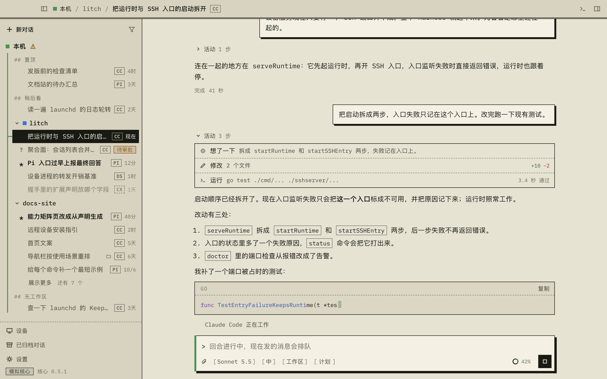
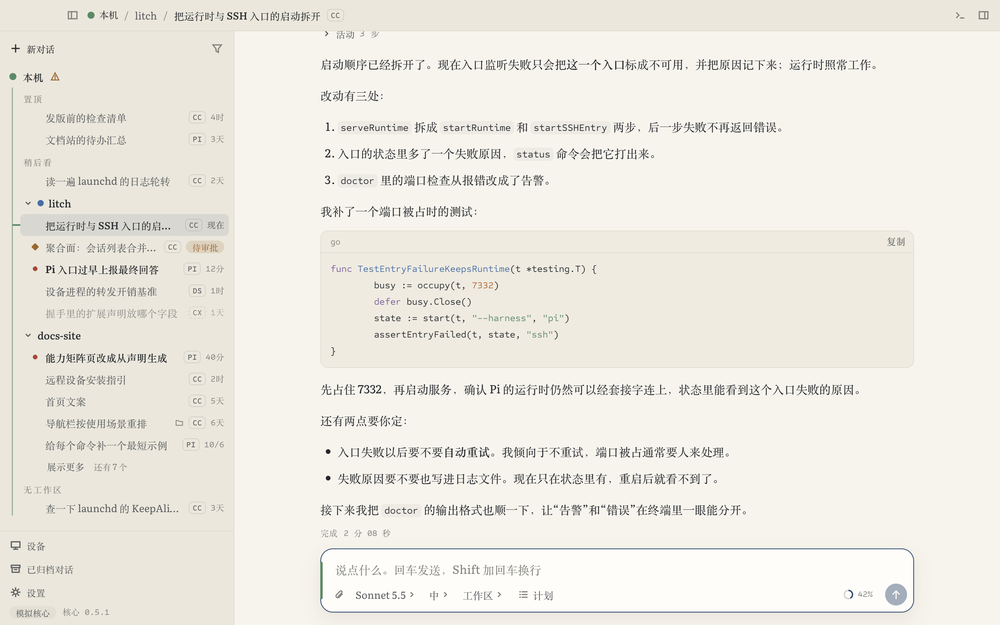
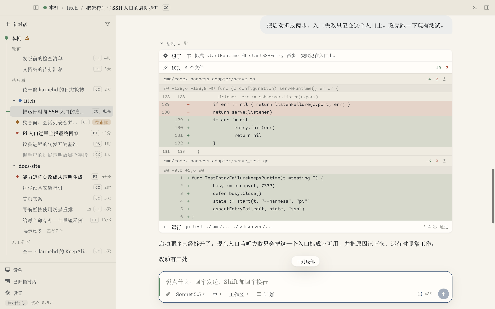
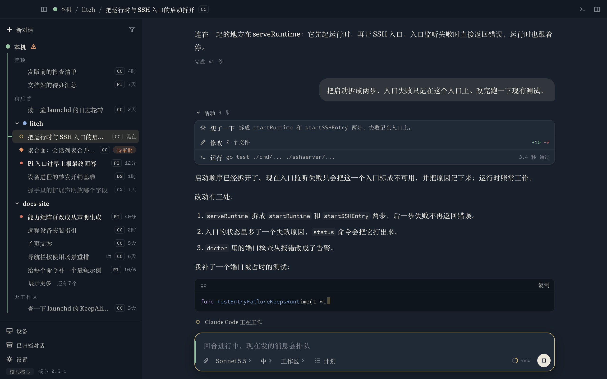

<p align="center">
  
</p>

# Litch

**简体中文** | [English](README.en.md)

Litch 致力于打造舒适的桌面客户端 + 远程连接体验。

- SSH 直连
- 移动端（Android、iOS）SSH 直连远程设备，桌面端不开也能用
- 内置浏览器 + Computer Use（macOS、Windows）
- 当桌面连接时，远程设备可使用桌面浏览器和 Computer Use 功能，经你点头后还能在这台电脑上跑命令、读写文件
- 会话树（跨 harness 派子会话、回报与唤醒）和定时任务（设备上按时跑，桌面端关着也照跑）
- 扫码把桌面端已经配好的远程设备绑到手机上，不用在手机上配 SSH 钥匙

<p></p>

## 界面

### 极客复古（默认）

<p></p>
<p></p>

### 文艺人文

<details>
<summary>展开看文艺人文皮肤</summary>

<p></p>
<p></p>
<p></p>

</details>

截图里是演示数据。皮肤、明暗、语言（中文 / English）都可以随时切换。

## 特性

- **远程连接。** 使用自己的 SSH 配置和密钥，只需设备的 SSH 服务可达，无需额外暴露 Litch 端口；断线自动重连。
- **多种 harness。** Claude Code、Pi、Codex，以及实验性的 DeepSeek Harness（DSH）、OpenCode 和 ACP agent（Gemini CLI、Qwen Code 等），收在同一个窗口里。
- **浏览器。** 内置浏览器供你和代理共用，远端的 localhost 自动经 SSH 转发；也可通过扩展操作你批准的 Chrome 标签与网站。
- **Computer Use（macOS、Windows）。** 开启后可操作普通应用；访问正式版 Litch 本身另需授权。操作时屏幕上有提示，按 Esc 停止。
- **操作这台电脑。** 远程设备上的代理经你点头后在桌面这台电脑上跑命令、读写文件、在两台机器之间复制文件；默认关，按设备打开。
- **会话树。** 会话可以派出子会话，而且跨 harness：Claude Code 的会话能派 Codex、Pi 等的子会话，反过来也行；子会话挂在父会话下面；结束时回报给父会话，必要时把它唤醒接着做。
- **定时任务。** 任务存在设备上、由设备按时执行，桌面端关着、断开了也照跑；每次新建会话或在已有会话里接着发。
- **扫码绑定手机。** 桌面端（或那台机器上的 `litch pair`）出二维码，手机扫码后生成自己的钥匙、登记到那台机器上，你在电脑上核对确认码点允许；电脑的钥匙不离开电脑，每部手机能单独撤销。
- **写代码的面板。** 终端（断线不丢）、文件树、差异审阅。
- **移动端（Android、iOS）。** 经 SSH 直连远程设备：看会话、发消息、审批、开终端、管理定时任务；支持扫码配对与平板分栏。

Android 和 iOS 内置 Tailscale，不占用系统 VPN，可与已有 VPN 共存。连接策略有“自动、总是、从不”；内置节点登录后，自动模式会识别 tailnet 地址，无需手动切换，详见[手机连接手册](skills/litch-manual/references/phones.md#内嵌-tailscale-网络)。

## 当前状态

| 部分 | 状态 |
|---|---|
| 适配器 `codex-harness-adapter` | 连接一台设备上的多个 harness，见[安装与使用](ADAPTER.md) |
| 桌面客户端 | 提供 macOS（Apple Silicon）与 Windows 安装包，自带适配器；支持本机和远程会话、浏览器、Computer Use，以及经授权操作桌面电脑的命令和文件 |
| Android 客户端 | 提供 APK，支持会话、审批、终端、文件、经理和定时任务 |
| iOS 客户端 | 具备手机端的远程会话、审批、终端、文件、经理和定时任务能力。目前在 TestFlight 内部测试，准备提交 App Store，尚无公开下载。iOS 单独发版，不随桌面端和 Android 一起发布 |

具体功能与平台限制见[产品手册](skills/litch-manual/SKILL.md)。

## 通用模块

Computer Use、内置浏览器和 Chrome 控制拆成了独立的包，别的桌面应用也能嵌入。三者共用 [`third_party/litch-automation/packages/automation-contracts`](third_party/litch-automation/packages/automation-contracts) 里的工具定义和宿主接口（调用与取消、审批、状态存储等）；路径、身份、审批界面都由宿主传入，导入时不读个人目录，也不登记任何东西。

- **[Computer Use](third_party/litch-automation/packages/computer-use)。** 操作 macOS、Windows 普通应用的执行器，负责原生助手的启动、看护和通信。只需 Node 24，不依赖 Electron；原生助手由宿主自己构建、签名，随自己的应用分发。
- **[内置浏览器](third_party/litch-automation/packages/browser)。** 基于 CDP 的浏览器工具执行器，带站点许可、代填登录和 Cookie、密码导入。Electron 宿主用 `/electron` 子入口直接接入；默认入口不加载 Electron，非 Electron 宿主提供自己的 CDP 页面宿主，或直接实现语义接口 `BrowserDriver`。
- **Chrome 控制。** [扩展库](third_party/litch-automation/packages/chrome-extension)用来组装宿主自己的 MV3 扩展（自己的扩展 ID 和 host 名），提供标签租约和受限 CDP 执行器；[本机桥](third_party/litch-automation/packages/chrome-bridge)在 Node 进程里登记 Native Messaging、与扩展通信，并提供 AI 工具执行器，不依赖 Electron。

通用模块的源码已集成在 `third_party/litch-automation`，对应公开代码库 [slovx2/litch-automation](https://github.com/slovx2/litch-automation)（MIT，npm 尚未首发）：提供五个包的源码，以及 macOS Swift、Windows Rust 原生助手的源码和构建脚本。独立仓库不签名、公证、打包或发布预编译助手；Litch、WakeQora 等使用方从源码自行构建、签名并随自己的应用分发。npm 正式包名为 `@litch/*`，各包独立 semver，首版为 `0.x`；源码和包版本与 Litch 版本独立。构建、接入示例和限制见各包的 README。

通用模块源码修改后正常重建 Litch 即可验证，无须先发布 npm。提交前将改动回写独立仓，并同步 `third_party/litch-automation.lock.json`；`npm run check:shared-modules` 验证提交 SHA 和源码文件哈希。原生 helper 的产品身份、组装、签名和公证仍由 Litch 构建脚本管理。

回写时使用 `git subtree split --prefix=third_party/litch-automation` 导出提交；上游合入后用 `git subtree pull --prefix=third_party/litch-automation <上游仓库> main --squash` 更新，再执行 `node scripts/sync-shared-modules.mjs <上游完整提交SHA>`。首次安装运行 `npm run automation:setup`，只构建源码，不发布版本。

## 下载

从[发布页](https://github.com/slovx2/litch/releases/latest)下载：

| 系统 | 文件 | 说明 |
|---|---|---|
| macOS（Apple Silicon） | `Litch-<版本>-macos-arm64.dmg` | 签过名，经过苹果公证。打开后把 Litch 拖进“应用程序” |
| Windows（x64） | `Litch-<版本>-windows-x64-setup.exe` | 支持 Windows 11，终端使用 Windows PowerShell；管理员账号暂不能扫码配对。安装程序未签名，仅安装给当前用户，无需管理员权限 |
| 安卓（arm64，Android 7.0 及以上） | `Litch-<版本>-android-arm64.apk` | 直接安装，第一次系统会让你允许“安装未知应用”。应用自己生成一把 SSH 钥匙，把它的公钥加到远程机器的 `authorized_keys` 里就能连 |

应用自带一份适配器，打开就把本机上装了的 Claude Code、Pi、DSH、OpenCode 和 codex 收在“本机”这台设备下；这些 harness 本身要另外装好并登录。Intel 芯片的 Mac 暂时没有安装包，可以从源码运行。

它还会把一个技能“Litch 产品手册”（`litch-manual`，源文件在 [`skills/litch-manual`](skills/litch-manual)）装进本机的 harness（放在 `~/.agents/skills`，并链到 `~/.claude/skills` 等处），Agent 能照着它讲解 Litch、用 `litch config` 命令改设置；不想要可以在设置里关掉。

## 从源码运行

需要 Node.js 24。

```sh
git clone https://github.com/slovx2/litch.git
cd litch
npm ci
npm run client:setup
npm run client:start:mock
```

这样看到的是演示数据。要看真实的会话，先按[适配器说明](ADAPTER.md)把适配器跑起来，再把它的套接字交给客户端：

```sh
LITCH_ENTRY=~/.codex-harness-adapter/pi/runtime.sock npm run client:start
```

`pi` 可以换成 `claude-code`；换成 `~/.codex-harness-adapter/device/device.sock` 就是一条连接里有全部 harness；也可以填原生 codex 用 `codex app-server --listen unix://<路径>` 监听的套接字。

在 macOS 上可以打成一个能直接打开的应用，放在 `apps/desktop/out` 下面。先跑过上面的 `npm run client:setup`；它自带一份适配器，所以还要把适配器构建出来（需要 Go）：

```sh
npm run setup
npm run client:pack
open apps/desktop/out/Litch-darwin-arm64/Litch.app
```

打开之后它会自己拉起那份适配器，本机上装了的 Claude Code、Pi、DSH、OpenCode 和 codex 出现在“本机”这台设备下（codex 用的是你自己的那份数据，默认在 `~/.codex`，不想要可以在设备页里停用）；没装的会写明原因，在设备页里可以填命令的路径或者停用。适配器的状态目录是 `~/.codex-harness-adapter`，和独立安装的适配器共用；退出应用后服务留着，会话不断。

自己打的这一份只做了本机的临时签名，换一台机器打开会被系统拦下；Computer Use 的系统权限也认签名，每重新打一次包就要重新授权。要给别人用、或者长期用 Computer Use，用发布页上的安装包。

## 文档

[适配器的安装与使用](ADAPTER.md) · [开发约定](AGENTS.md) · [参与开发](CONTRIBUTING.md)

---

适配器基于 [fuergaosi233/claude-codex](https://github.com/fuergaosi233/claude-codex)。[MIT](LICENSE) · [第三方许可](THIRD_PARTY_NOTICES.md)

